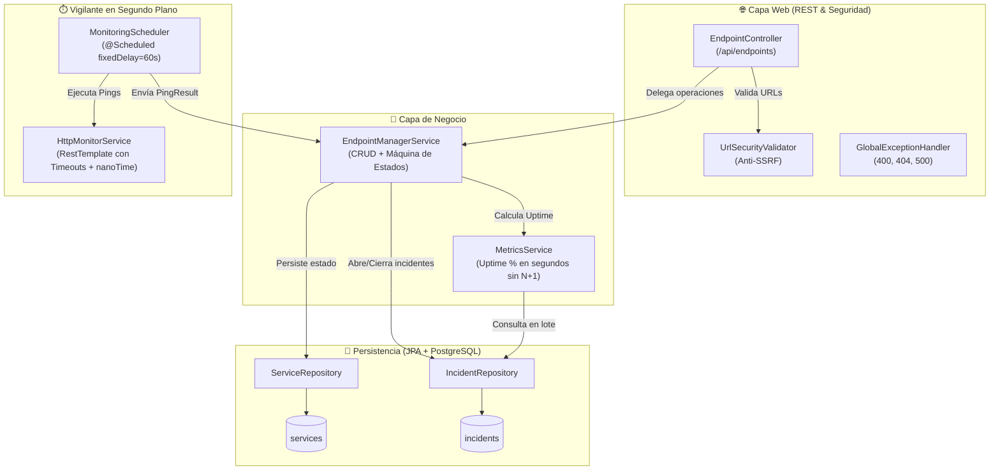

# DeployOps

Plataforma B2B para centralizar el monitoreo de salud proactivo, el historial de latencias y la gestión de incidentes de servicios en tiempo real.

[](https://adoptium.net/)
[](https://spring.io/projects/spring-boot)
[](https://www.postgresql.org/)
[](https://www.docker.com/)
[](./.github/workflows/backend-ci.yml)

---

## Sobre el proyecto

Cuando desarrollamos y mantenemos varias APIs o microservicios, la información operativa suele estar dispersa. **DeployOps** reúne todo en un panel central, permitiendo registrar servicios, ejecutar health checks programados de manera asíncrona con timeouts, detectar caídas instantáneamente mediante una máquina de estados estricta y calcular métricas reales de disponibilidad (Uptime) y latencia.

### Características del Backend Core (v1.0 Implementado):

- **Monitoreo Asíncrono Resiliente:** Tarea programada (`@Scheduled` con `fixedDelay = 60s`) que ejecuta pings HTTP con timeouts estrictos (3s conexión, 5s lectura) y medición monotónica de latencia en milisegundos (`System.nanoTime`).
- **Máquina de Estados con Tolerancia a Fallos:** Previene falsos positivos (`PENDING` $\rightarrow$ `HEALTHY` $\rightarrow$ `DEGRADED` [1-2 fallos] $\rightarrow$ `DOWN` [3 fallos seguidos, abre incidente] $\rightarrow$ `RECOVERING` [1er éxito] $\rightarrow$ `HEALTHY` [2 éxitos seguidos, cierra incidente]).
- **Seguridad contra SSRF (Server-Side Request Forgery):** Bloqueo a nivel de red para `localhost`, `127.0.0.1`, IPs privadas y endpoints de metadatos cloud.
- **Cálculo de Uptime Optimizado:** Ventana móvil de 30 días con precisión de segundos, resolviendo el problema de las **N+1 queries** mediante consultas en lote a PostgreSQL.
- **Calidad y CI/CD Automático:** Suite de **10 pruebas unitarias** con JUnit 5 y Mockito ejecutadas automáticamente en GitHub Actions antes de cada despliegue en Render.

---

## Arquitectura del Backend



---

## Documentación del Proyecto

Toda la especificación técnica, de diseño y arquitectónica ha sido modularizada para mantener este archivo limpio:

- **[Arquitectura del Sistema (`docs/ARCHITECTURE.md`)](./docs/ARCHITECTURE.md):** Describe el diseño estructural en capas del backend (Spring Boot), componentes y flujo del ciclo de monitoreo.
- **[Dominio y Reglas de Negocio (`docs/DOMAIN_AND_RULES.md`)](./docs/DOMAIN_AND_RULES.md):** Contiene la lógica central de la aplicación, el modelo de datos en PostgreSQL y el diagrama de la máquina de estados.
- **[Decisiones Técnicas ADR (`docs/DECISIONS.md`)](./docs/DECISIONS.md):** Registro formal de las decisiones de diseño arquitectónico (monolito en capas, PostgreSQL/Supabase, mitigación SSRF, resolución N+1, WebSockets).

---

## Stack Tecnológico

| Capa | Tecnologías |
| :--- | :--- |
| **Backend** | Java 21, Spring Boot, Spring Data JPA, Spring Boot Actuator, Hibernate Validator |
| **Frontend** | Angular, TypeScript, RxJS, Signals, TailwindCSS *(En desarrollo)* |
| **Base de Datos** | PostgreSQL (Docker local para dev / Supabase Cloud para prod) |
| **DevOps & Cloud** | Docker multi-stage, Render Web Service, GitHub Actions CI |
| **Testing** | JUnit 5, Mockito |

---

## Roadmap de Desarrollo

- [x] **Fase 1: Configuración inicial**
  - Estructura de monorepo (Spring Boot + Angular).
  - Definición de arquitectura, dominio y ADRs.
- [x] **Fase 2: Backend Core v1.0 (Completado y Desplegado)**
  - CRUD de endpoints con Bean Validation y DTOs seguros.
  - Tareas programadas (`@Scheduled`) con medición de latencia y timeouts HTTP.
  - Máquina de estados tolerante a fallos (`PENDING`, `HEALTHY`, `DEGRADED`, `DOWN`, `RECOVERING`).
  - Persistencia de estado e incidentes en PostgreSQL (Supabase / Docker).
  - Cálculo de Uptime optimizado sin problema N+1.
  - Protección de seguridad contra ataques SSRF.
  - Pipeline de CI en GitHub Actions con pruebas unitarias de Mockito y JUnit 5.
- [ ] **Fase 3: Dashboard en Angular**
  - Consumo del Backend REST con Angular y Signals.
  - Vista de tarjetas, badges de estado, métricas de latencia y uptime.
  - Formularios de alta y confirmación de borrado.
- [ ] **Fase 4: Tiempo Real y Proactividad**
  - Actualización reactiva de la UI vía WebSockets (STOMP).
  - Generación de reportes PDF y envío por Email *(Roadmap futuro)*.
- [ ] **Fase 5: Multiplataforma y Pulido**
  - Adaptación a cliente móvil *(Roadmap futuro)*.

---

## Ejecución en Entorno Local

### 1. Levantar PostgreSQL con Docker Compose:
```bash
docker compose up -d
```

### 2. Ejecutar las pruebas unitarias:
```bash
cd backend
./mvnw test
```

### 3. Iniciar la API de Spring Boot:
```bash
cd backend
./mvnw spring-boot:run
```
La API estará disponible en `http://localhost:8080/api/endpoints`.
