# DeployOps

Plataforma de observabilidad y monitoreo proactivo de disponibilidad HTTP, auditoría de certificados SSL y gestión de incidentes en tiempo real.

Enlace a la aplicación en producción: [https://deployopsapp.vercel.app/](https://deployopsapp.vercel.app/)

[](https://adoptium.net/)
[](https://spring.io/projects/spring-boot)
[](https://angular.dev/)
[](https://threejs.org/)
[](https://www.postgresql.org/)
[](https://redis.io/)
[](https://www.rabbitmq.com/)
[](https://www.docker.com/)
[](./.github/workflows/backend-ci.yml)
[](https://github.com/Marcosdaag/deploy-ops)

---

## Galería Visual de la Plataforma

### 1. Panel Principal con Globo 3D de Telemetría Global
Visualización inmersiva en WebGL con Three.js que representa la red de nodos del clúster geolocalizados, arcos de datos intercontinentales y métricas de salud en tiempo real sobre una textura procedural de 4096x2048 px con contornos vectoriales continentales de Natural Earth.

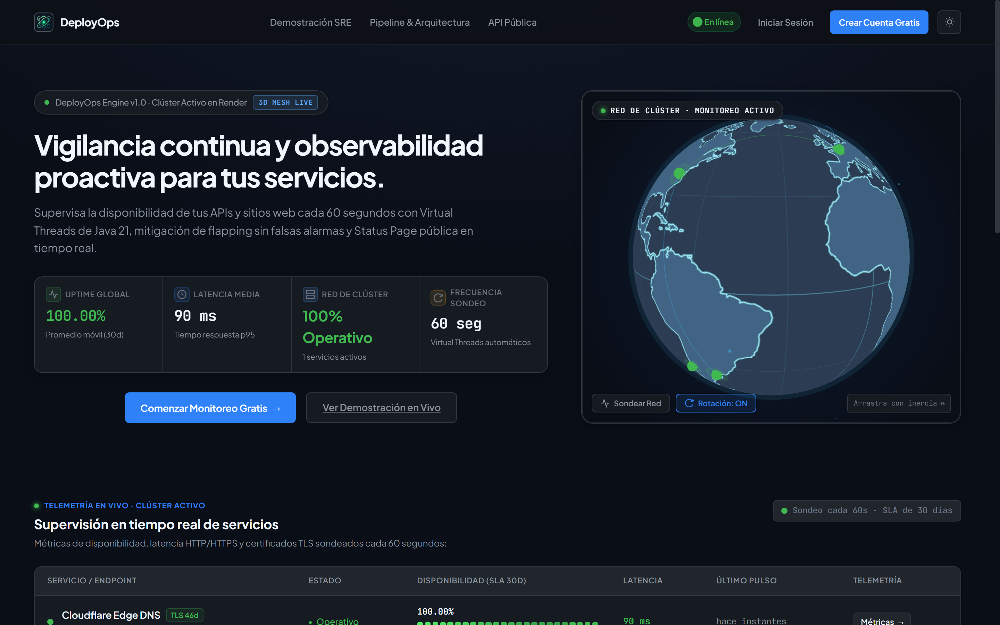

### 2. Libro Mayor de Observabilidad SRE (Observability Ledger)
Arquitectura desacoplada y de alta densidad que erradica el anidamiento artificial de tarjetas (sin contenedores redundantes ni bordes duplicados). Presenta latencias p95 monoespaciadas, ritmos de disponibilidad SLA a 30 días, monitoreo de certificados TLS y estado sincronizado del clúster en un único pie técnico integrado.

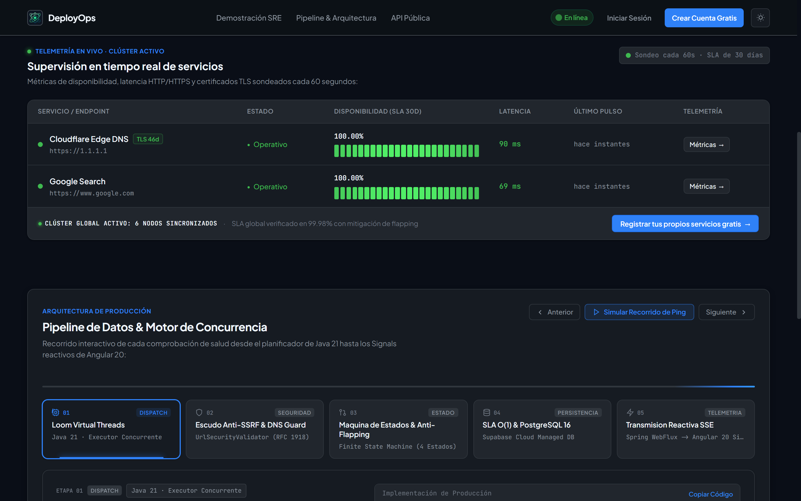

### 3. Pipeline de Datos y Motor de Concurrencia
Explorador de arquitectura interactivo que desglosa el ciclo de vida de cada comprobación: desde el despachador de Virtual Threads de Java 21 (Project Loom), la validación de seguridad perimetral anti-SSRF, la máquina de estados finitos hasta la persistencia O(1) y la emisión reactiva Server-Sent Events (SSE).

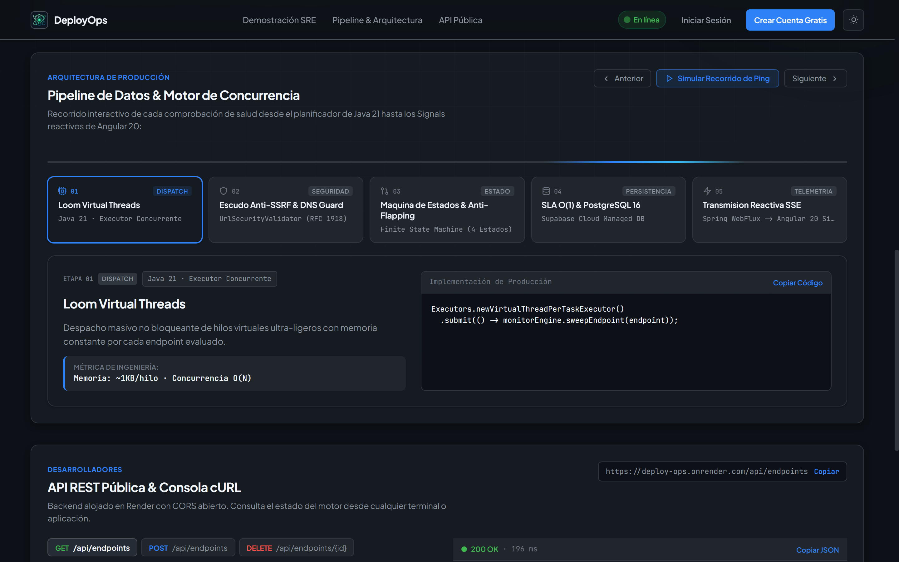

### 4. Consola REST Pública y Terminal cURL Interactiva
Consola técnica desacoplada para desarrolladores con navegación por pestañas de métodos HTTP (`GET`, `POST`), inspección de cabeceras de seguridad, previsualización de respuestas JSON y comandos cURL listos para copiar y ejecutar en terminal.

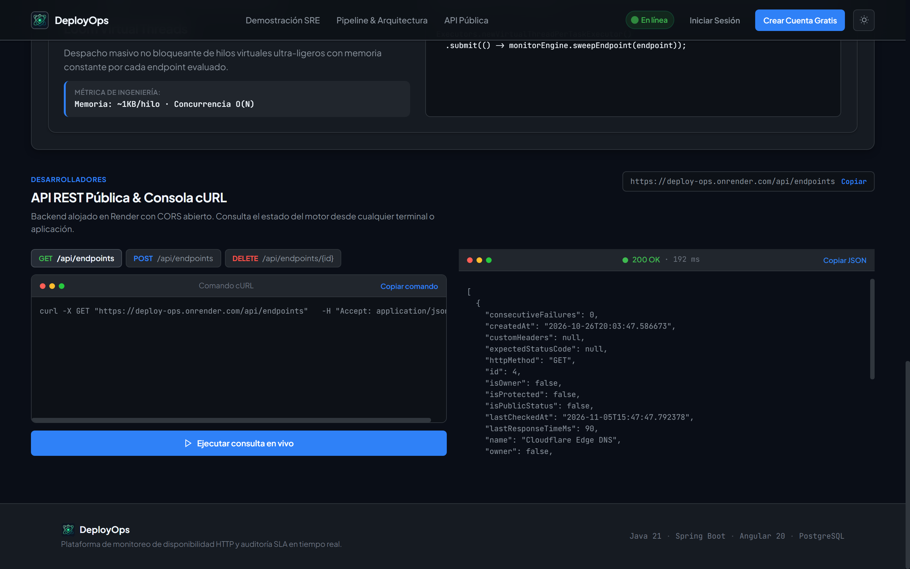

### 5. Soporte Integral de Modo Claro (Light Mode)
Sistema de diseño conmutable de descanso visual inspirado en estándares de GitHub Primer, Stripe y Linear, asegurando contraste estricto WCAG 2.1 AA e iluminación atmosférica balanceada.

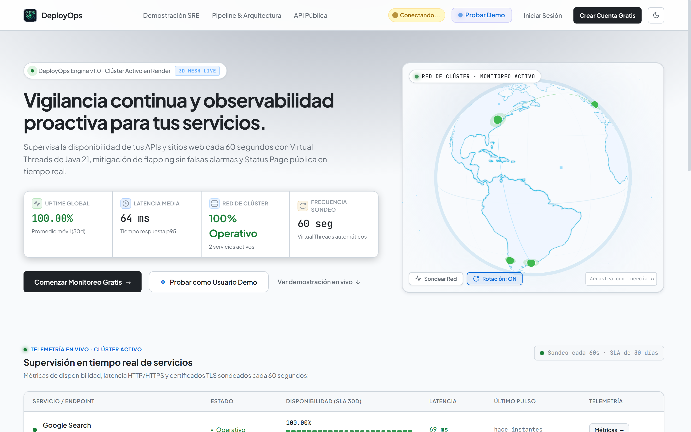

### 6. Adaptabilidad Total en Dispositivos Móviles (375px)
Diseño responsive de precisión verificado en pantallas móviles: colapso inteligente de navegación, adaptación de métricas, protección de ancho mínimo en tablas de telemetría y cero desbordamiento horizontal (`hasOverflow: false`).

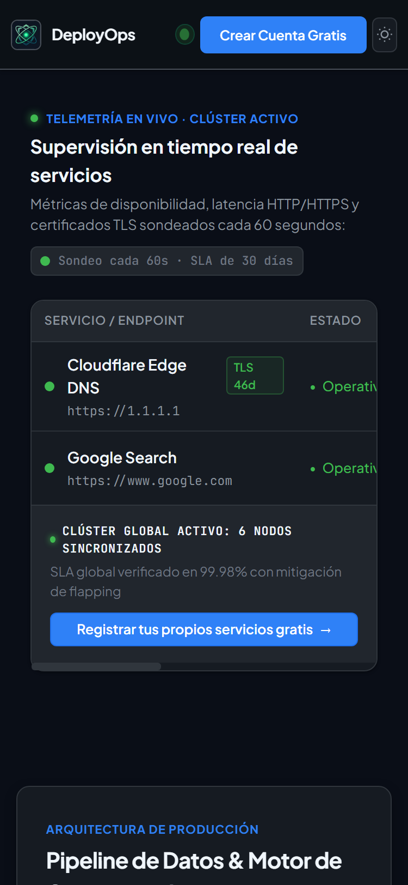

### 7. Modo Demo Interactivo sin Registro
Acceso de prueba inmediato con rol de operador SRE para explorar el panel privado de control, interactuar con telemetría en tiempo real, añadir endpoints y probar pings sin necesidad de vincular cuentas externas ni registros previos.

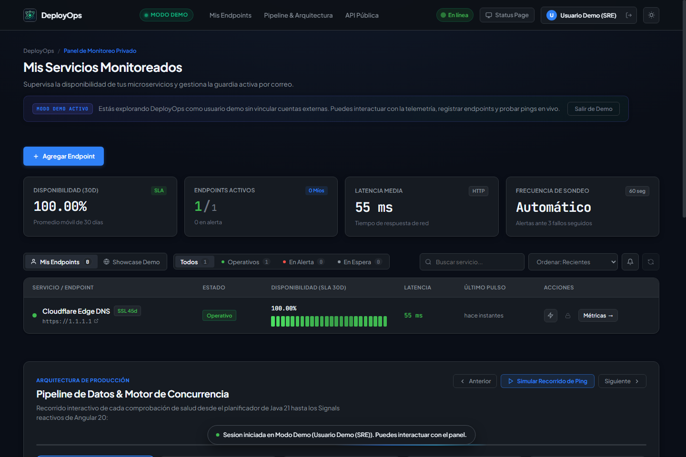

---

## Descripción General

DeployOps es una solución diseñada para centralizar la telemetría, el control de disponibilidad y el ciclo de vida de incidentes en infraestructuras web y microservicios. A diferencia de las herramientas tradicionales basadas en sondeos pasivos, DeployOps implementa un motor de ejecución asíncrona concurrente mediante Virtual Threads (Java 21), una máquina de estados finitos que erradica falsas alarmas y un perímetro estricto de validación contra vulnerabilidades Server-Side Request Forgery (SSRF).

La plataforma opera en dos niveles: un panel operativo autenticado con aislamiento de recursos privados y un motor de Status Page pública accesible mediante identificadores desacoplados (slugs) para mantener informados a los usuarios finales.

---

## Capacidades Técnicas del Sistema

### 1. Monitoreo Concurrente con Hilos Virtuales
- Planificación periódica fija (`@Scheduled(fixedDelay = 60000)`) orquestada mediante `Executors.newVirtualThreadPerTaskExecutor()`.
- Pings HTTP sin bloqueo de sockets del sistema operativo, con timeouts estrictos (3 segundos de conexión, 5 segundos de lectura).
- Medición de latencia monotónica de alta precisión en milisegundos a través de `System.nanoTime()`, eliminando discrepancias por desfases de reloj de sistema (NTP).
- Inspección directa de certificados TLS/SSL mediante sockets `X509Certificate` para alertar anticipadamente sobre vencimientos de certificados.

### 2. Máquina de Estados Finitos y Mitigación de Falsos Positivos
El motor de evaluación evita alertar ante parpadeos transitorios de red mediante una política estricta de tres confirmaciones:
- `PENDING`: Estado inicial honesto asignado en la creación. Ningún servicio asume 100% de disponibilidad antes de su primer sondeo.
- `HEALTHY`: El servicio responde con el código de estado esperado.
- `DEGRADED`: Primer o segundo fallo consecutivo de red. Se registra la anomalía sin disparar una declaración formal de incidente.
- `DOWN`: Confirmación de tres fallos consecutivos (3/3). Se abre formalmente un registro de incidente (`ONGOING`) con marca temporal inmutable.
- `RECOVERING`: Primera respuesta satisfactoria posterior a una caída. Si reincide en el siguiente ciclo, regresa a `DOWN`.
- Resolución: Requiere dos respuestas exitosas consecutivas en `RECOVERING` para transicionar a `HEALTHY` y sellar el incidente como `RESOLVED`.

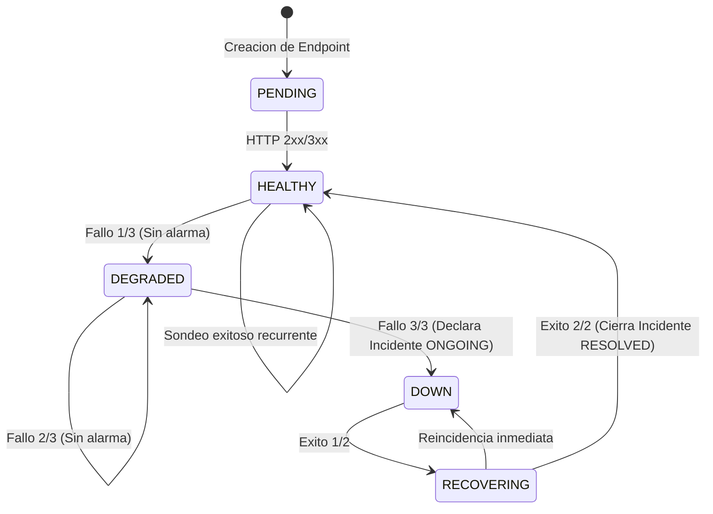

### 3. Escudo de Seguridad contra Server-Side Request Forgery (SSRF)
Dado que el sistema recibe URLs arbitrarias provistas por los usuarios, `UrlSecurityValidator` ejecuta una inspección defensiva previa a cada conexión:
- Restricción estricta de esquemas: únicamente se autorizan `http` y `https`.
- Deshabilitación de redirecciones automáticas en la capa HTTP para prevenir ataques de redirección abierta hacia interfaces internas.
- Resolución de nombres DNS vía `InetAddress` y descarte inmediato de direcciones de loopback (`127.0.0.0/8`), enlaces locales (`169.254.0.0/16`), Carrier-Grade NAT (`100.64.0.0/10`) y subredes privadas RFC 1918 (`10.0.0.0/8`, `172.16.0.0/12`, `192.168.0.0/16`).
- Protección de endpoints de metadatos de proveedores Cloud (`169.254.169.254`, `fd00:ec2::254`).
- Bloqueo de puertos sensibles comúnmente asociados a bases de datos, administración de sistemas y contenedores (SSH, Docker, Redis, PostgreSQL, MySQL, Kubernetes API, Elasticsearch).

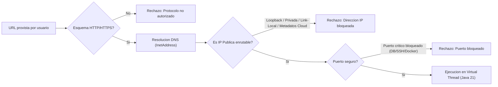

### 4. Cálculo de Disponibilidad SLA sin Problema N+1
- Algoritmo de cálculo de disponibilidad sobre ventana móvil de 30 días con precisión de segundos.
- Consulta JPQL en lote (`findOverlappingIncidentsForServices`) que recupera todos los incidentes que cruzan la ventana temporal en un único viaje de red, agrupando los datos en memoria en tiempo constante.

### 5. Telemetría en Vivo y Canal Unidireccional
- Emisión reactiva de eventos vía Server-Sent Events (SSE) a través de `/api/endpoints/stream`.
- El cliente web mantiene la vista sincronizada sin incurrir en peticiones periódicas agresivas (*polling*), reduciendo la sobrecarga sobre el balanceador y la base de datos.

### 6. Seguridad y Control de Tasa (Rate Limiting)
- Autenticación sin estado basada en JSON Web Tokens (JWT) firmados criptográficamente y contraseñas cifradas con `BCrypt`.
- Filtro de control de tasa (`RateLimitingFilter`) que implementa el algoritmo Token Bucket por dirección IP, protegiendo los endpoints de autenticación y creación contra abusos.
- Cabeceras HTTP de seguridad y política CORS configurada por lista blanca de orígenes.

### 7. Observabilidad Visual 3D y Telemetría Geoespacial (Three.js WebGL)
- Esfera interactiva de telemetría global desarrollada con Three.js (r187) y Angular 20.3.
- Mapeo esférico geodésico exacto con coordenadas reales de clústeres: US-East (`38.0, -78.0`), Buenos Aires (`-34.6, -58.4`), Santiago (`-33.4, -70.7`), París/Frankfurt (`48.8, 2.3`), Tokio (`35.7, 139.7`) y Sídney (`-33.9, 151.2`).
- Textura cartográfica de 4096 x 2048 px con contornos vectoriales continentales de Natural Earth, trazo dual de resplandor y anisotropía x4.
- Modelo físico de rotación con inercia y fricción cinemática (arrastre libre y continuación suave de giro sin reseteo de orientación).
- Libro Mayor SRE (*Observability Ledger*) unificado y desacoplado, sin anidamiento artificial de tarjetas ni contenedores de caja redundantes.

---

## Arquitectura de Componentes (v2.0 Enterprise)

```mermaid
flowchart TD
    subgraph Cliente ["Capa de Presentacion (Angular 20.3 + Three.js r187)"]
        Dashboard["Dashboard Component<br/>(Signals + Control Flow)"]
        Globe3D["TelemetryCanvas3dComponent<br/>(Three.js WebGL Engine)"]
        StatusPage["Status Page Component<br/>(Public Slug View)"]
        EnterpriseHub["EnterpriseHubComponent<br/>(Webhooks, DLQ, Caos, Telemetria)"]
        SSEClient["SSE Reactive Client"]
    end

    subgraph Perimetro ["Perimetro de Seguridad y Red"]
        RLF["RateLimitingFilter + RateLimiterService<br/>(Token Bucket + Redis INCR Global)"]
        JWTF["JwtAuthenticationFilter<br/>(Validacion de Tokens JWT)"]
        SSRF["UrlSecurityValidator<br/>(Anti-SSRF + Anti-DNS-Rebinding Pre-Vuelo)"]
    end

    subgraph Core ["Capa de Negocio y Resiliencia (Spring Boot 4.1.1)"]
        EMS["EndpointManagerService<br/>(FSM 5 Estados + Transaccion ACID Outbox)"]
        MS["MetricsService<br/>(Calculo Uptime SLA 30d sin N+1)"]
        MHS["MetricsHistoryService<br/>(Series 6h-30d + Purga ShedLock)"]
        RS["ReportService<br/>(Exportacion CSV y Alertas Email)"]
        SPS["StatusPageService<br/>(Agregacion Publica por Slug)"]
        SPCS["StatusPageCacheService<br/>(Cache L2 Redis TTL 60s + Eviccion Reactiva)"]
        SSEN["SseNotificationService<br/>(Transmision SSE en Tiempo Real)"]
        OES["OutboxEventService<br/>(Persistencia Inmutable de Eventos)"]
        ORS["OutboxRelayService<br/>(Relay ShedLock + Zombie Lock Reaper)"]
        WDS["WebhookDeliveryService<br/>(AES-256-GCM + HMAC-SHA256 + Backoff/Jitter)"]
        CS["ChaosSimulationService<br/>(Inyeccion de Caos SRE y Degradacion)"]
    end

    subgraph Messaging ["Broker de Mensajeria (RabbitMQ 3.13)"]
        RMQ["Topic Exchange: deployops.incidents<br/>Colas: webhooks.dispatch, audit.telemetry"]
        DLQ["Dead Letter Exchange: deployops.incidents.dlx<br/>Cola: webhooks.dlq"]
    end

    subgraph Background ["Motor Asincrono Concurrente"]
        SCH["MonitoringScheduler<br/>(@Scheduled 60s + @SchedulerLock)"]
        VT["Virtual Thread Executor<br/>(Java 21 Loom)"]
        HM["HttpMonitorService<br/>(HTTP Check Monotonico + Auditoria TLS X.509)"]
    end

    subgraph Persistencia ["Persistencia y Memoria Distribuida"]
        RED[("Redis 7.2<br/>ShedLock + Cache L2 + Rate Limit")]
        PG[("PostgreSQL 16<br/>7 Tablas Relacionales")]
    end

    Dashboard --> Globe3D & EnterpriseHub
    Dashboard --> RLF
    StatusPage --> RLF
    RLF --> RED
    RLF --> JWTF
    JWTF --> EMS & SPS & CS
    EMS --> SSRF
    EMS --> OES
    OES --> PG
    SCH --> VT
    VT --> HM
    HM --> EMS
    EMS --> SPCS
    SPCS --> RED
    EMS --> SSEN
    SSEN -.->|Server-Sent Events| SSEClient
    EMS --> PG
    ORS --> PG
    ORS --> RMQ
    RMQ --> WDS
    WDS --> DLQ
    WDS --> PG
```

---

## Cobertura de Pruebas y Calidad de Código

El repositorio cuenta con una suite integral de **214 pruebas automatizadas** ejecutadas en entornos de integración continua:

| Módulo | Pruebas | Framework / Herramientas | Enfoque |
| :--- | :--- | :--- | :--- |
| **Backend Core** | 163 | JUnit 5, Mockito, MockMvc, H2, Testcontainers RabbitMQ 1.20.4 | Validación anti-SSRF (44 tests), transiciones FSM, cálculo Uptime sin N+1, purga de logs, auditoría SSL, control de tasa (Redis/memoria), JWT/OAuth2, Outbox Relay, cifrado AES-256-GCM, firmas HMAC, DLQ y simulador de caos |
| **Frontend SPA** | 51 | Jasmine, Karma, ChromeHeadless | Reactividad de Signals, Enterprise Hub (4 pestañas), gestión de webhooks, visor DLQ, canvas WebGL 3D, drawers de inspección (6h/24h/7d/30d), snippets cURL, servicios HTTP e interceptores |
| **Total** | **214** | **100% pruebas pasando exitosamente** | **0 fallos, 0 errores en CI** |

---

## Especificación de la API REST

DeployOps v2.0 Enterprise expone **33 endpoints organizados en 5 controladores temáticos**:

### 1. Autenticación y Cuentas (5 Endpoints)
| Método | Endpoint | Acceso | Descripción |
| :--- | :--- | :--- | :--- |
| `POST` | `/api/auth/register` | Público | Registro de nuevo usuario con contraseña cifrada en BCrypt. |
| `POST` | `/api/auth/login` | Público | Autenticación de credenciales y emisión de token JWT. |
| `POST` | `/api/auth/google` | Público | Autenticación mediante token ID de Google verificado criptográficamente. |
| `POST` | `/api/auth/demo` | Público | Inicio de sesión instantáneo con cuenta de demostración SRE y endpoints precargados. |
| `GET` | `/api/auth/me` | Autenticado | Retorna el perfil y slug público del usuario actual. |

### 2. Gestión de Endpoints y Telemetría SRE (14 Endpoints)
| Método | Endpoint | Acceso | Descripción |
| :--- | :--- | :--- | :--- |
| `GET` | `/api/endpoints` | Autenticado / Público | Lista de servicios según alcance (`scope=mine` o `scope=showcase`). |
| `POST` | `/api/endpoints` | Autenticado | Registro de un nuevo endpoint con validación anti-SSRF. |
| `POST` | `/api/endpoints/samples` | Autenticado | Siembra automática de endpoints de prueba para cuentas recién creadas. |
| `PUT` | `/api/endpoints/{id}` | Autenticado (Owner) | Actualización de parámetros, URL y umbrales de respuesta. |
| `DELETE` | `/api/endpoints/{id}` | Autenticado (Owner) | Eliminación segura en cascada del servicio y sus incidentes asociados. |
| `PATCH` | `/api/endpoints/{id}/visibility` | Autenticado (Owner) | Conmuta visibilidad pública para inclusión en Status Page (`isPublicStatus`). |
| `POST` | `/api/endpoints/{id}/ping` | Autenticado / Público | Disparo inmediato de comprobación HTTP bajo demanda ejecutado en Loom. |
| `POST` | `/api/endpoints/{id}/test-alert` | Autenticado (Owner) | Disparo de alerta SMTP de prueba a la casilla de correo del operador. |
| `GET` | `/api/endpoints/{id}/metrics` | Autenticado / Owner | Historial de latencias y estado según rango (`6h`, `24h`, `7d`, `30d`). |
| `GET` | `/api/endpoints/{id}/incidents` | Autenticado / Owner | Bitácora de incidentes activos y resueltos con duración en segundos. |
| `GET` | `/api/endpoints/{id}/report` | Autenticado (Owner) | Reporte mensual agregado de disponibilidad SLA y conteo de incidentes en JSON. |
| `GET` | `/api/endpoints/{id}/report/csv` | Autenticado (Owner) | Exportación descargable de reporte mensual de disponibilidad SLA en formato CSV. |
| `POST` | `/api/endpoints/{id}/report/email` | Autenticado (Owner) | Envío del reporte mensual de disponibilidad SLA adjunto por correo electrónico. |
| `GET` | `/api/endpoints/stream` | Público | Flujo unidireccional de Server-Sent Events con métricas en tiempo real. |

### 3. Páginas de Estado Públicas (Status Pages) (2 Endpoints)
| Método | Endpoint | Acceso | Descripción |
| :--- | :--- | :--- | :--- |
| `GET` | `/api/status/{slug}` | Público | Estado consolidado de los servicios públicos con respaldo de Caché L2 en Redis. |
| `PATCH` | `/api/status/slug` | Autenticado | Actualiza el slug personalizado del operador (ej. `/status/acme-corp`). Invalida caché L2. |

### 4. Webhooks y Mensajería Criptográfica (8 Endpoints)
| Método | Endpoint | Acceso | Descripción |
| :--- | :--- | :--- | :--- |
| `GET` | `/api/webhooks` | Autenticado | Lista receptores configurados con secreto enmascarado (`dops_sec_••••••••4f9a`). |
| `POST` | `/api/webhooks` | Autenticado | Alta de webhook (Slack, Discord, Custom) con generación de secreto HMAC. |
| `PATCH` | `/api/webhooks/{id}` | Autenticado (Owner) | Modificación de nombre, URL destino, proveedor o activación/pausa. |
| `DELETE` | `/api/webhooks/{id}` | Autenticado (Owner) | Eliminación del webhook y auditorías asociadas. |
| `POST` | `/api/webhooks/{id}/rotate-secret` | Autenticado (Owner) | Rotación criptográfica inmediata del secreto HMAC-SHA256. |
| `POST` | `/api/webhooks/{id}/test` | Autenticado (Owner) | Envío de evento de prueba `WEBHOOK_TEST_PING` firmado con HMAC. |
| `GET` | `/api/webhooks/failures` | Autenticado | Auditoría de entregas fallidas derivadas a Dead Letter Queue (`webhooks.dlq`). |
| `POST` | `/api/webhooks/failures/{id}/retry` | Autenticado (Owner) | Reintento manual firmado de un mensaje fallido derivado a DLQ. |

### 5. Telemetría Distribuida y Caos SRE (4 Endpoints)
| Método | Endpoint | Acceso | Descripción |
| :--- | :--- | :--- | :--- |
| `GET` | `/api/distributed/overview` | Público | Indicadores de clúster (buffer Outbox, hits/misses de caché L2, estado Redis/AMQP). |
| `GET` | `/api/chaos/state` | Público / Token | Consulta el código HTTP simulado actual del sandbox (`200`, `503`, `504`, `401`). |
| `POST` | `/api/chaos/state` | Público / Token | Conmuta el código HTTP simulado del sandbox para pruebas de contingencia. |
| `POST` | `/api/chaos/trigger` | Público / Token | Dispara un evento `CHAOS_SIMULATION` para validar el flujo completo hacia DLQ. |

> [!NOTE]
> Para la documentación técnica exhaustiva de parámetros, códigos de estado y cuotas de Rate Limiting de cada endpoint, consulta la [Referencia Completa de la API REST](./docs/API_REFERENCE.md).

---

## Modelo de Datos (7 Tablas Relacionales)

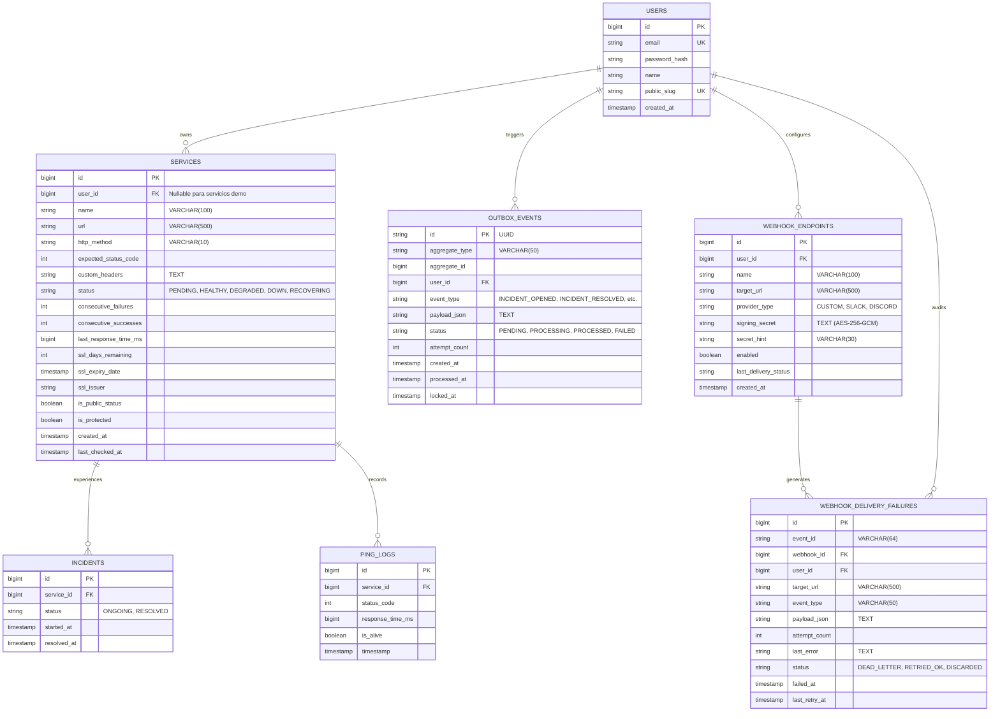

---

## Variables de Entorno

### Backend (Spring Boot 4.1.1)
| Variable | Descripción | Valor por Defecto |
| :--- | :--- | :--- |
| `PORT` | Puerto de escucha del servidor HTTP | `8080` |
| `DB_URL` | URL JDBC de conexión a PostgreSQL | `jdbc:postgresql://localhost:5432/deployops_db` |
| `DB_USER` | Usuario de base de datos | `admin` |
| `DB_PASSWORD` | Contraseña de base de datos | `adminpassword` |
| `JWT_SECRET` | Clave secreta para firma y verificación de tokens | Cadena interna de desarrollo |
| `JWT_EXPIRATION_MS` | Tiempo de vida del token en milisegundos | `86400000` (24 horas) |
| `CORS_ALLOWED_ORIGINS` | Orígenes web autorizados separados por coma | `https://deployopsapp.vercel.app,https://deploy-ops-rho.vercel.app,http://localhost:4200` |
| `GOOGLE_CLIENT_ID` | Identificador OAuth2 de cliente Google para validación de `aud` | Cadena vacía (opcional) |
| `MAIL_ENABLED` | Habilitación del despachador de alertas por correo | `false` |
| `MAIL_HOST` | Servidor SMTP para envío de alertas | `smtp.gmail.com` |
| `MAIL_PORT` | Puerto SMTP | `587` |
| `MAIL_USERNAME` | Cuenta de correo emisora | Cadena vacía |
| `MAIL_PASSWORD` | Contraseña de aplicación SMTP | Cadena vacía |
| `MAIL_FROM` | Remitente visible en los correos | `alerts@deployops.io` |
| `REDIS_ENABLED` | Habilitación de Redis para ShedLock, Caché L2 y Rate Limiter | `false` (Fallback automático en memoria) |
| `REDIS_URL` | URL de conexión a Redis 7.2 | `redis://localhost:6379` |
| `REDIS_TIMEOUT` | Timeout de conexión con Redis | `2s` |
| `STATUS_CACHE_TTL_SECONDS` | Tiempo de vida del caché L2 de Status Page | `60` segundos |
| `RABBITMQ_ENABLED` | Habilitación del broker RabbitMQ para el pipeline de eventos | `false` (Fallback a Virtual Threads) |
| `RABBITMQ_URL` | Dirección de conexión AMQP a RabbitMQ | `amqp://localhost:5672` |
| `WEBHOOK_ENCRYPTION_KEY` | Clave simétrica de 32 bytes para cifrado AES-256-GCM | Cadena interna de 32 bytes |

### Frontend (Angular 20.3)
| Variable / Archivo | Descripción |
| :--- | :--- |
| `src/environments/environment.development.ts` | Configuración para desarrollo local apuntando a `http://localhost:8080/api/endpoints` |
| `src/environments/environment.ts` | Configuración de producción apuntando a la API en Render |

---

## Ejecución en Entorno Local

### Requisitos Previos
- Java Development Kit (JDK) 21 LTS o superior
- Node.js versión 20.x o 22.x LTS
- Docker y Docker Compose

### 1. Iniciar la Infraestructura Local (PostgreSQL 16, Redis 7.2, RabbitMQ 3.13)
```bash
docker compose up -d
```

### 2. Ejecutar y Probar el Backend
```bash
cd backend

# Ejecutar las 163 pruebas unitarias y de integracion
./mvnw test

# Iniciar la aplicacion
./mvnw spring-boot:run
```
La API estará accesible en `http://localhost:8080`.

### 3. Ejecutar y Probar el Frontend
```bash
cd frontend

# Instalar dependencias
npm install

# Ejecutar las 51 pruebas unitarias
npm test -- --watch=false --browsers=ChromeHeadless

# Iniciar servidor de desarrollo
npm start
```
El panel web estará disponible en `http://localhost:4200`.

---

## Licencia y Mantenimiento

Proyecto desarrollado y mantenido por Marcos Daniel Aguirre como solución integral de observabilidad web y gestión proactiva de servicios. Código fuente bajo licencia MIT.
