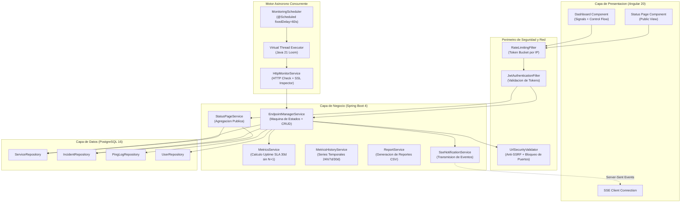
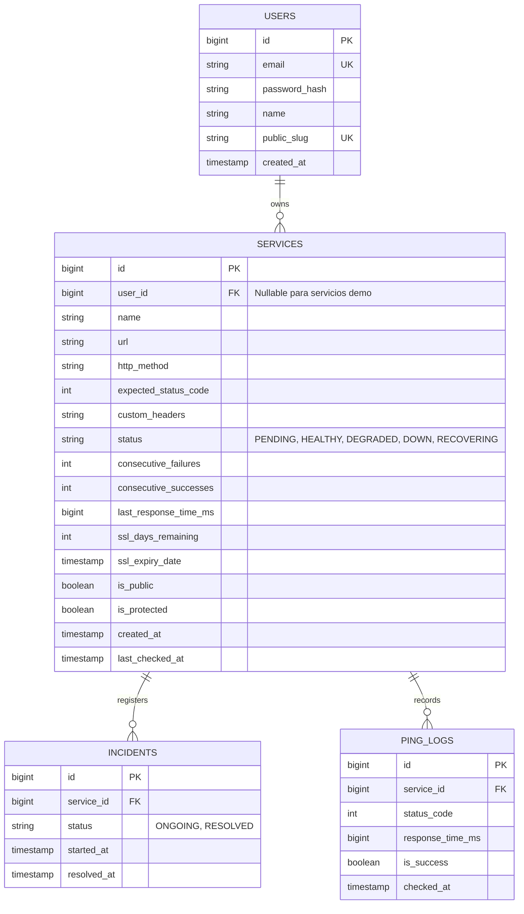

# DeployOps

Plataforma de observabilidad y monitoreo proactivo de disponibilidad HTTP, auditoría de certificados SSL y gestión de incidentes en tiempo real.

Enlace a la aplicación en producción: [https://deployopsapp.vercel.app/](https://deployopsapp.vercel.app/)

[](https://adoptium.net/)
[](https://spring.io/projects/spring-boot)
[](https://angular.dev/)
[](https://www.postgresql.org/)
[](https://www.docker.com/)
[](./.github/workflows/backend-ci.yml)
[](https://github.com/Marcosdaag/deploy-ops)

---

## Descripción General

DeployOps es una solución diseñada para centralizar la telemetría, el control de disponibilidad y el ciclo de vida de incidentes en infraestructuras web y microservicios. A diferencia de las herramientas tradicionales basadas en sondeos pasivos, DeployOps implementa un motor de ejecución asíncrona concurrente mediante Virtual Threads (Java 21), una máquina de estados finitos que erradica falsas alarmas y un perímetro estricto de validación contra vulnerabilidades Server-Side Request Forgery (SSRF).

La plataforma opera en dos niveles: un panel operativo autenticado con aislamiento de recursos privados y un motor de Status Page pública accesible mediante identificadores desacoplados (slugs) para mantener informados a los usuarios finales.

---

## Capacidades Técnicas del Sistema

### 1. Monitoreo Concurrente con Hilos Virtuales
- Planificación periódica fija (`@Scheduled(fixedDelay = 60000)`) orquestada mediante `Executors.newVirtualThreadPerTaskExecutor()`.
- Pings HTTP sin bloqueo de sockets del sistema operativo, con timeouts estrictos (3 segundos de conexión, 5 segundos de lectura).
- Medición de latencia monotónica de alta precisión en milisegundos a través de `System.nanoTime()`, eliminando discrepancias por desfases de reloj de sistema (NTP).
- Inspección directa de certificados TLS/SSL mediante sockets `X509Certificate` para alertar anticipadamente sobre vencimientos de certificados.

### 2. Máquina de Estados Finitos y Mitigación de Falsos Positivos
El motor de evaluación evita alertar ante parpadeos transitorios de red mediante una política estricta de tres confirmaciones:
- `PENDING`: Estado inicial honesto asignado en la creación. Ningún servicio asume 100% de disponibilidad antes de su primer sondeo.
- `HEALTHY`: El servicio responde con el código de estado esperado.
- `DEGRADED`: Primer o segundo fallo consecutivo de red. Se registra la anomalía sin disparar una declaración formal de incidente.
- `DOWN`: Confirmación de tres fallos consecutivos (3/3). Se abre formalmente un registro de incidente (`ONGOING`) con marca temporal inmutable.
- `RECOVERING`: Primera respuesta satisfactoria posterior a una caída. Si reincide en el siguiente ciclo, regresa a `DOWN`.
- Resolución: Requiere dos respuestas exitosas consecutivas en `RECOVERING` para transicionar a `HEALTHY` y sellar el incidente como `RESOLVED`.

### 3. Escudo de Seguridad contra Server-Side Request Forgery (SSRF)
Dado que el sistema recibe URLs arbitrarias provistas por los usuarios, `UrlSecurityValidator` ejecuta una inspección defensiva previa a cada conexión:
- Restricción estricta de esquemas: únicamente se autorizan `http` y `https`.
- Deshabilitación de redirecciones automáticas en la capa HTTP para prevenir ataques de redirección abierta hacia interfaces internas.
- Resolución de nombres DNS vía `InetAddress` y descarte inmediato de direcciones de loopback (`127.0.0.0/8`), enlaces locales (`169.254.0.0/16`), Carrier-Grade NAT (`100.64.0.0/10`) y subredes privadas RFC 1918 (`10.0.0.0/8`, `172.16.0.0/12`, `192.168.0.0/16`).
- Protección de endpoints de metadatos de proveedores Cloud (`169.254.169.254`, `fd00:ec2::254`).
- Bloqueo de puertos sensibles comúnmente asociados a bases de datos, administración de sistemas y contenedores (SSH, Docker, Redis, PostgreSQL, MySQL, Kubernetes API, Elasticsearch).

### 4. Cálculo de Disponibilidad SLA sin Problema N+1
- Algoritmo de cálculo de disponibilidad sobre ventana móvil de 30 días con precisión de segundos.
- Consulta JPQL en lote (`findOverlappingIncidentsForServices`) que recupera todos los incidentes que cruzan la ventana temporal en un único viaje de red, agrupando los datos en memoria en tiempo constante.

### 5. Telemetría en Vivo y Canal Unidireccional
- Emisión reactiva de eventos vía Server-Sent Events (SSE) a través de `/api/endpoints/stream`.
- El cliente web mantiene la vista sincronizada sin incurrir en peticiones periódicas agresivas (*polling*), reduciendo la sobrecarga sobre el balanceador y la base de datos.

### 6. Seguridad y Control de Tasa (Rate Limiting)
- Autenticación sin estado basada en JSON Web Tokens (JWT) firmados criptográficamente y contraseñas cifradas con `BCrypt`.
- Filtro de control de tasa (`RateLimitingFilter`) que implementa el algoritmo Token Bucket por dirección IP, protegiendo los endpoints de autenticación y creación contra abusos.
- Cabeceras HTTP de seguridad y política CORS configurada por lista blanca de orígenes.

---

## Arquitectura de Componentes



---

## Cobertura de Pruebas y Calidad de Código

El repositorio cuenta con una suite integral de **148 pruebas automatizadas** ejecutadas en entornos de integración continua:

| Módulo | Pruebas | Framework / Herramientas | Enfoque |
| :--- | :--- | :--- | :--- |
| **Backend Core** | 116 | JUnit 5, Mockito, MockMvc, H2 Database | Validación anti-SSRF (44 tests), transiciones de máquina de estados, cálculo de Uptime sin N+1, purga de logs, auditoría SSL y autenticación JWT |
| **Frontend SPA** | 32 | Jasmine, Karma, ChromeHeadless | Reactividad de Signals, filtrado de estados, ordenamiento de telemetría, drawers de inspección, servicios HTTP e interceptores de autenticación |
| **Total** | **148** | **100% pruebas pasando exitosamente** | **0 fallos, 0 errores en CI** |

---

## Especificación de la API REST

### Autenticación y Cuentas
| Método | Endpoint | Acceso | Descripción |
| :--- | :--- | :--- | :--- |
| `POST` | `/api/auth/register` | Público | Registro de nuevo usuario con contraseña cifrada en BCrypt. |
| `POST` | `/api/auth/login` | Público | Autenticación de credenciales y emisión de token JWT. |
| `GET` | `/api/auth/me` | Autenticado | Retorna el perfil y slug público del usuario actual. |

### Gestión de Endpoints y Monitoreo
| Método | Endpoint | Acceso | Descripción |
| :--- | :--- | :--- | :--- |
| `GET` | `/api/endpoints` | Autenticado / Público | Lista de servicios según alcance (`scope=mine` o `scope=showcase`). |
| `POST` | `/api/endpoints` | Autenticado | Registro de un nuevo endpoint con validación anti-SSRF. |
| `PUT` | `/api/endpoints/{id}` | Autenticado | Actualización de parámetros, URL y umbrales de respuesta. |
| `DELETE` | `/api/endpoints/{id}` | Autenticado | Eliminación segura en cascada del servicio y sus incidentes asociados. |
| `POST` | `/api/endpoints/{id}/ping` | Autenticado | Disparo inmediato de comprobación HTTP bajo demanda. |
| `GET` | `/api/endpoints/{id}/metrics` | Autenticado | Historial de latencias y estado según rango (`24h`, `7d`, `30d`). |
| `GET` | `/api/endpoints/{id}/incidents` | Autenticado | Bitácora de incidentes activos y resueltos con duración en segundos. |
| `GET` | `/api/endpoints/{id}/report/csv` | Autenticado | Exportación descargable de reporte mensual de disponibilidad SLA en formato CSV. |
| `GET` | `/api/endpoints/stream` | Público | Flujo unidireccional de Server-Sent Events con métricas en tiempo real. |

### Status Page Pública
| Método | Endpoint | Acceso | Descripción |
| :--- | :--- | :--- | :--- |
| `GET` | `/api/status/{slug}` | Público | Estado consolidado de los servicios públicos marcados por el usuario. |

---

## Modelo de Datos



---

## Variables de Entorno

### Backend (Spring Boot)
| Variable | Descripción | Valor por Defecto |
| :--- | :--- | :--- |
| `PORT` | Puerto de escucha del servidor HTTP | `8080` |
| `DB_URL` | URL JDBC de conexión a PostgreSQL | `jdbc:postgresql://localhost:5432/deployops_db` |
| `DB_USER` | Usuario de base de datos | `admin` |
| `DB_PASSWORD` | Contraseña de base de datos | `adminpassword` |
| `JWT_SECRET` | Clave secreta para firma y verificación de tokens | Cadena interna de desarrollo |
| `JWT_EXPIRATION_MS` | Tiempo de vida del token en milisegundos | `86400000` (24 horas) |
| `CORS_ALLOWED_ORIGINS` | Orígenes web autorizados separados por coma | `https://deployopsapp.vercel.app,http://localhost:4200` |
| `MAIL_ENABLED` | Habilitación del despachador de alertas por correo | `false` |
| `MAIL_HOST` | Servidor SMTP para envío de alertas | `smtp.gmail.com` |
| `MAIL_PORT` | Puerto SMTP | `587` |
| `MAIL_USERNAME` | Cuenta de correo emisora | Cadena vacía |
| `MAIL_PASSWORD` | Contraseña de aplicación SMTP | Cadena vacía |
| `MAIL_FROM` | Remitente visible en los correos | `alerts@deployops.io` |

### Frontend (Angular)
| Variable / Archivo | Descripción |
| :--- | :--- |
| `src/environments/environment.ts` | Configuración para desarrollo local apuntando a `http://localhost:8080` |
| `src/environments/environment.prod.ts` | Configuración de producción apuntando a la API en Render |

---

## Ejecución en Entorno Local

### Requisitos Previos
- Java Development Kit (JDK) 21 o superior
- Node.js versión 20 o superior
- Docker y Docker Compose

### 1. Iniciar la Base de Datos Local
```bash
docker compose up -d
```

### 2. Ejecutar y Probar el Backend
```bash
cd backend

# Ejecutar las 116 pruebas unitarias y de integracion
./mvnw test

# Iniciar la aplicacion
./mvnw spring-boot:run
```
La API estará accesible en `http://localhost:8080`.

### 3. Ejecutar y Probar el Frontend
```bash
cd frontend

# Instalar dependencias
npm install

# Ejecutar las 32 pruebas unitarias
npm test -- --watch=false --browsers=ChromeHeadless

# Iniciar servidor de desarrollo
npm start
```
El panel web estará disponible en `http://localhost:4200`.

---

## Licencia y Mantenimiento

Proyecto desarrollado y mantenido por Marcos Da Agostini como solución integral de observabilidad web y gestión proactiva de servicios. Código fuente bajo licencia MIT.
