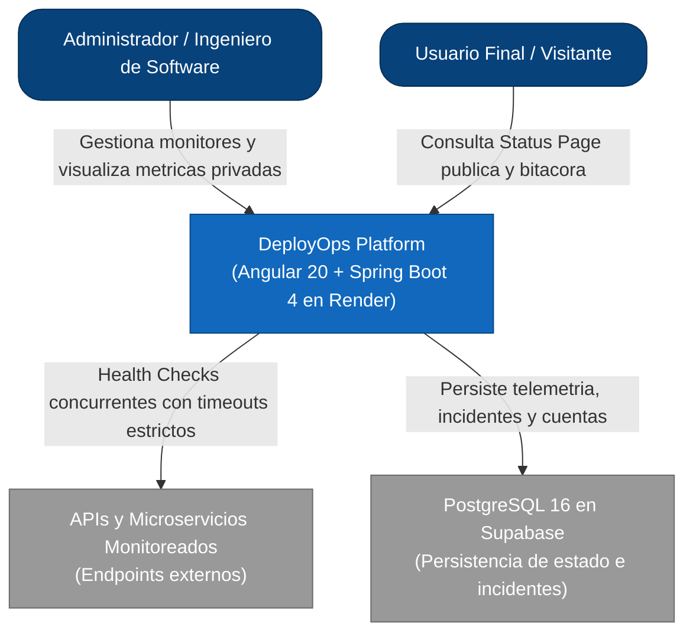
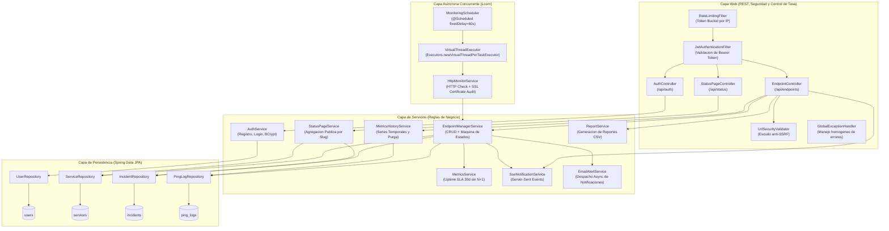
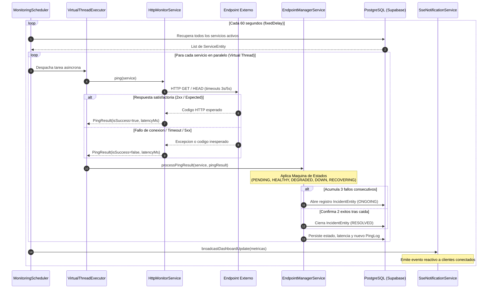

# Arquitectura del Sistema

Este documento describe la estructura técnica y de componentes de DeployOps, detallando las responsabilidades de cada capa, los flujos de comunicación y el procesamiento de monitoreo concurrente.

---

## 1. Contexto del Sistema (C4 Model)

El siguiente diagrama ilustra cómo interactúan los usuarios y los sistemas externos con el núcleo de la plataforma:

---

## 2. Arquitectura Interna del Backend (Spring Boot 4 / Java 21)

El backend sigue una arquitectura monolítica en capas estrictas bajo principios de inyección por constructor, inmutabilidad y separación de responsabilidades:

### Responsabilidades por Capa

1. **Capa Web y Perímetro de Seguridad:**
   - `RateLimitingFilter`: Aplica límites de consumo de peticiones por segundo utilizando el algoritmo Token Bucket basado en la IP de origen.
   - `JwtAuthenticationFilter`: Extrae y valida el token JWT de las cabeceras `Authorization: Bearer`, poblando el contexto de seguridad de Spring Security.
   - `EndpointController`: Expone las operaciones CRUD, telemetría y reportes para usuarios autenticados y vistas públicas.
   - `UrlSecurityValidator`: Analiza y valida cada URL previo a su almacenamiento o invocación, descartando subredes privadas, loopback, metadatos cloud y puertos restringidos.
   - `GlobalExceptionHandler`: Centraliza las excepciones controladas (`ResourceNotFoundException`, `SecurityException`, `MethodArgumentNotValidException`) transformándolas en un contrato unificado `ErrorResponseDTO`.

2. **Capa de Negocio (Core Services):**
   - `EndpointManagerService`: Coordina el ciclo de vida de los servicios, el aislamiento por usuario (`scope=mine` vs `scope=showcase`) y la máquina de estados finitos.
   - `MetricsService`: Ejecuta el cálculo ponderado de disponibilidad (Uptime) de los últimos 30 días con precisión de segundos, resolviendo el problema de las N+1 queries.
   - `MetricsHistoryService`: Agrupa los puntos de latencia para gráficos temporales (24 horas, 7 días, 30 días) y ejecuta la purga de logs antiguos.
   - `StatusPageService`: Resuelve la información pública agregada asociada a un slug personalizado.
   - `ReportService`: Formula el consolidado mensual de disponibilidad y genera el archivo CSV descargable.

3. **Capa de Monitoreo Asíncrono:**
   - `MonitoringScheduler`: Despacha un ciclo concurrente cada 60 segundos sobre hilos virtuales (`Virtual Threads`), ejecutando todos los pings en paralelo sin bloquear los núcleos del sistema operativo.
   - `HttpMonitorService`: Cliente HTTP con timeouts estrictos (3 segundos para conexión, 5 segundos para lectura) que mide el tiempo transcurrido con `System.nanoTime()` y extrae los metadatos de expiración del certificado X.509.

4. **Capa de Persistencia:**
   - Interfaces de Spring Data JPA sobre PostgreSQL en Supabase, implementando consultas nativas y JPQL optimizadas para lectura de rangos temporales superpuestos.

---

## 3. Flujo del Ciclo de Monitoreo Concurrente

