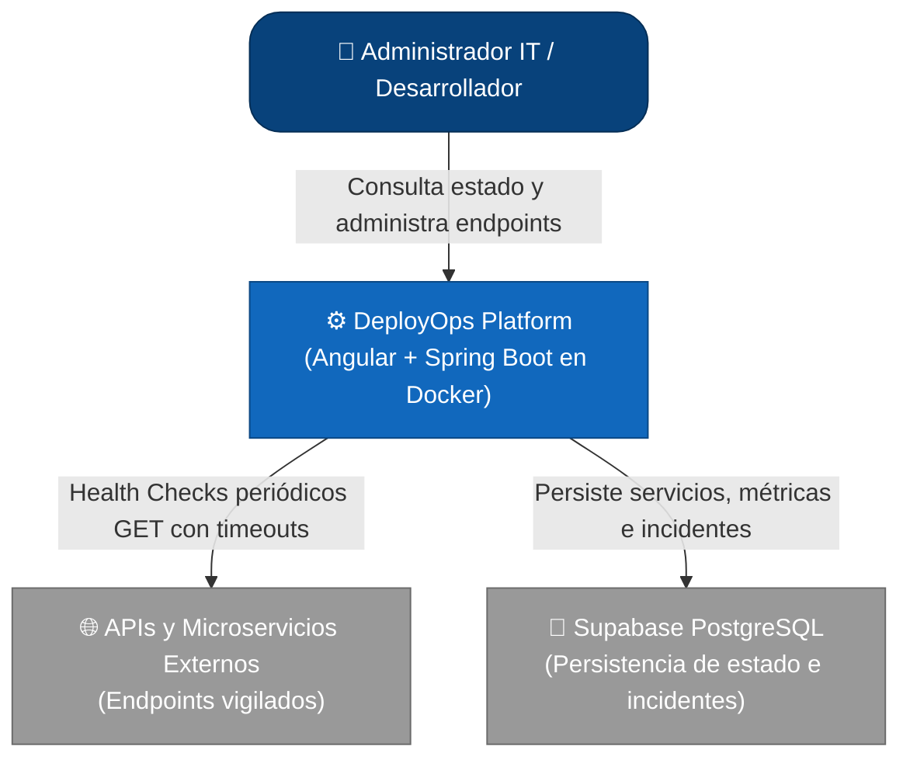
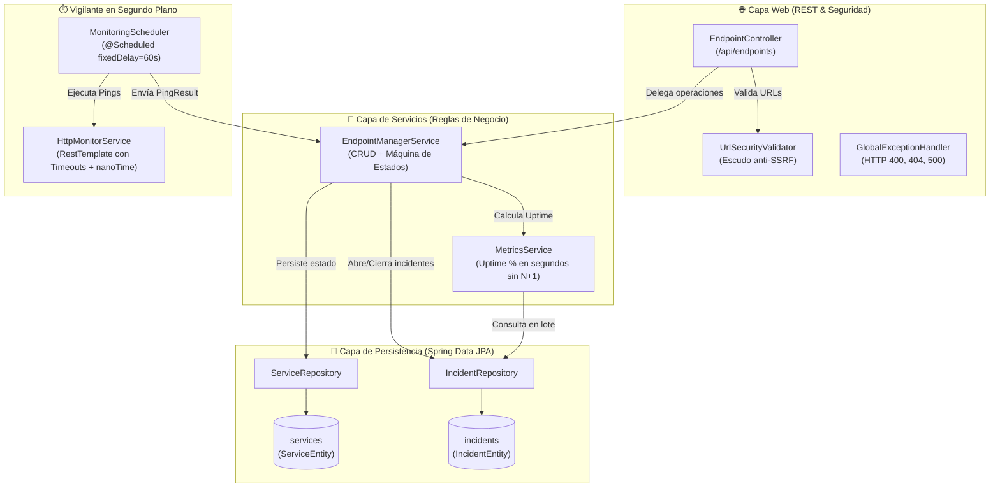
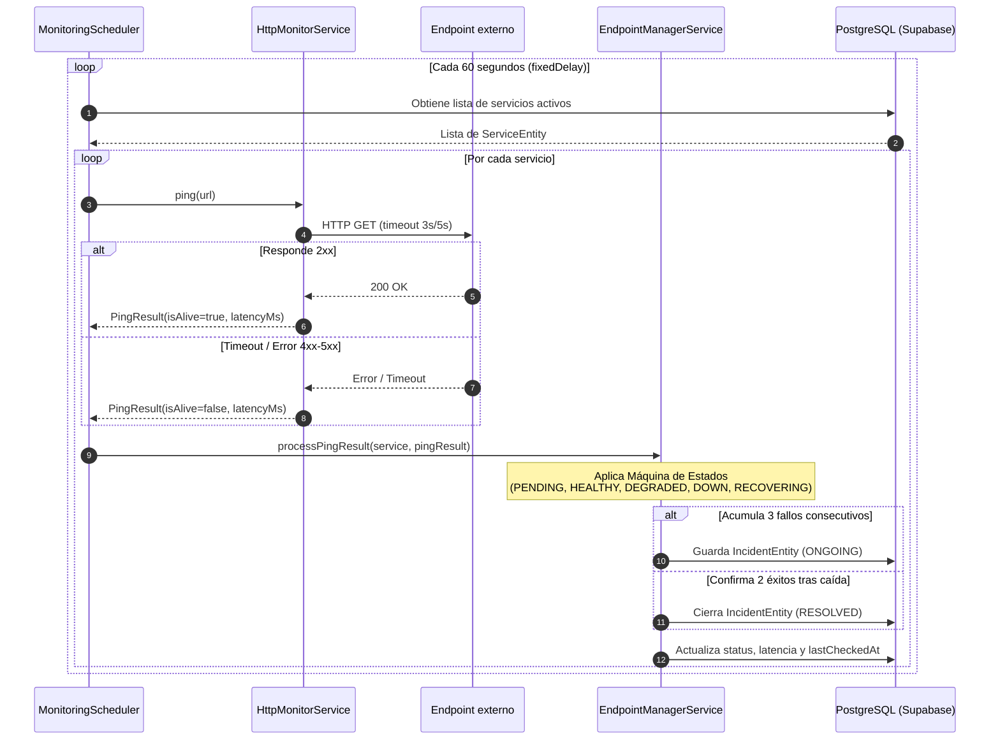

# Arquitectura del Sistema

Este documento describe cómo está estructurado **DeployOps** a nivel de código y componentes, detallando las responsabilidades de cada capa, el flujo de comunicación y el procesamiento de monitoreo.

---

## 1. C4 Model - Contexto del Sistema

El siguiente diagrama ilustra cómo interactúan los usuarios y los sistemas externos con el núcleo de la plataforma:

---

## 2. Arquitectura Interna del Backend (Spring Boot 4 / Java 21)

El backend sigue una arquitectura monolítica en capas estrictas bajo principios de **Inyección por Constructor**, inmutabilidad y separación de responsabilidades:

### Responsabilidades por Capa:
1. **Capa Web:**
   * `EndpointController`: Expone las rutas REST, recibe `EndpointCreateDTO` validado con Jakarta Validation (`@Valid`) y retorna `EndpointResponseDTO` (nunca expone entidades JPA directamente).
   * `UrlSecurityValidator`: Protege contra ataques SSRF bloqueando `localhost`, `127.0.0.1`, direcciones de loopback, IPs privadas y metadatos Cloud.
   * `GlobalExceptionHandler`: Centraliza las respuestas de error en un formato homogéneo (`ErrorResponseDTO`), ocultando detalles sensibles de base de datos en errores 500.
2. **Capa de Servicios (Core):**
   * `EndpointManagerService`: Orquesta el alta de servicios (inicializados en `PENDING`), el borrado seguro en cascada y la transición de estados tolerante a fallos.
   * `MetricsService`: Calcula la disponibilidad porcentual de los últimos 30 días con precisión de segundos, resolviendo el problema de las **N+1 queries** mediante consultas en lote.
3. **Capa Asíncrona / Scheduler:**
   * `MonitoringScheduler`: Tarea programada que ejecuta los checks con `fixedDelay = 60000` y aislamiento de excepciones por cada servicio.
   * `HttpMonitorService`: Cliente HTTP con `connectTimeout` de 3s y `readTimeout` de 5s, usando `Void.class` para no sobrecargar la memoria RAM con cuerpos pesados.
4. **Capa de Persistencia:**
   * `ServiceRepository` e `IncidentRepository`: Interfaces JPA sobre PostgreSQL (Supabase en producción / Docker local), con consultas JPQL optimizadas para solapamiento de ventanas temporales.

---

## 3. Flujo del Ciclo de Monitoreo

El ciclo de chequeo continuo funciona de la siguiente manera:

