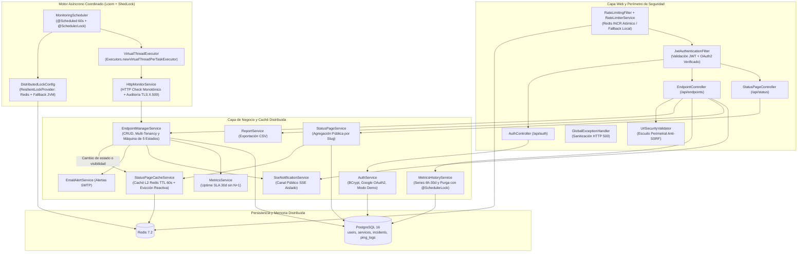
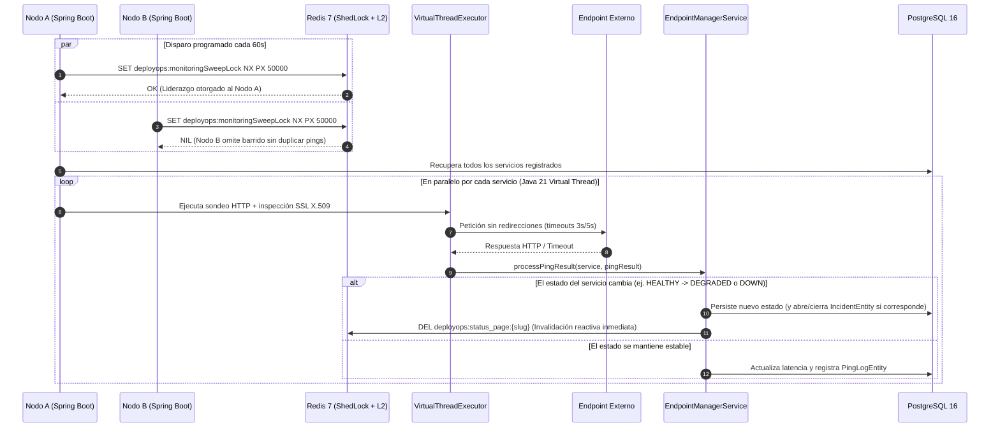
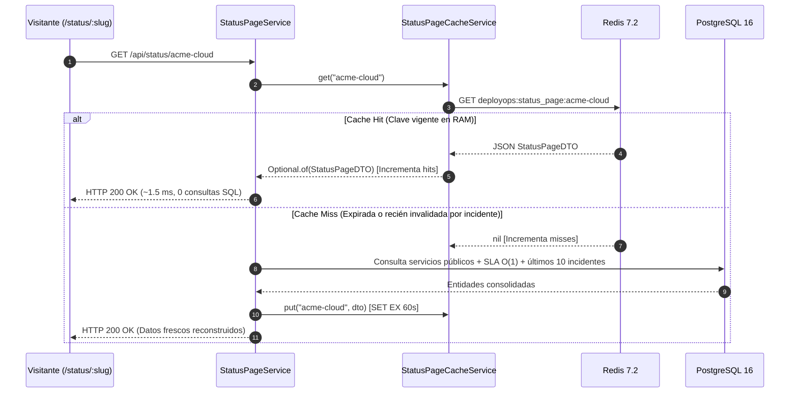
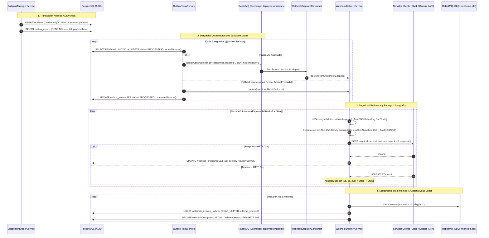

# Arquitectura del Sistema

Este documento describe la estructura técnica y de componentes de **DeployOps**, detallando las responsabilidades de cada capa, la coordinación distribuida multi-nodo y los flujos de comunicación reactiva.

---

## 1. Contexto del Sistema (C4 Model — Evolución v2.0 Fase 1)

El siguiente diagrama ilustra cómo interactúan los operadores SRE, los visitantes públicos y la infraestructura de datos y coordinación con el clúster de la plataforma:

```mermaid
flowchart TD
    classDef person fill:#08427b,stroke:#052e56,color:#fff,rx:20,ry:20
    classDef system fill:#1168bd,stroke:#0b4884,color:#fff
    classDef infra fill:#0f766e,stroke:#115e59,color:#fff
    classDef external fill:#64748b,stroke:#475569,color:#fff

    Admin["Operador SRE / Desarrollador"]:::person
    PublicUser["Usuario Final / Visitante"]:::person

    LB["Balanceador / Edge Proxy"]:::external
    DeployOps["Clúster DeployOps Core<br/>(Angular 20.3 + Nodos Spring Boot 4.1.1 / Loom)"]:::system
    Redis["Redis 7.2<br/>(ShedLock Leader Election + Caché L2 + Rate Limit Global)"]:::infra
    Postgres["PostgreSQL 16<br/>(Persistencia ACID de Cuentas, Servicios e Incidentes)"]:::infra
    APIs["APIs y Microservicios Monitoreados<br/>(Endpoints HTTP/TLS externos)"]:::external

    Admin -->|Gestiona endpoints y monitorea telemetría| LB
    PublicUser -->|Consulta Status Page pública /status/:slug| LB
    LB --> DeployOps
    DeployOps -->|Adquiere candado ShedLock, evalúa cuotas y lee/invalida Caché L2| Redis
    DeployOps -->|Persiste telemetría, incidentes y consultas SLA O(1)| Postgres
    DeployOps -->|Health Checks concurrentes con Virtual Threads y escudo Anti-SSRF| APIs
```

---

## 2. Arquitectura Interna del Backend (Spring Boot 4.1.1 / Java 21)

El backend implementa una arquitectura en capas estrictas con soporte híbrido para despliegue distribuido multi-nodo y degradación elegante (*Fail-Open*) en entornos de nodo único:



---

## 3. Flujo del Ciclo de Monitoreo Coordinado Multi-Nodo



---

## 4. Flujo de Lectura e Invalidación Reactiva en Status Page (Caché L2)




---

## 5. Ciclo de Vida del Transactional Outbox y Topologia AMQP hacia Dead Letter Queue


