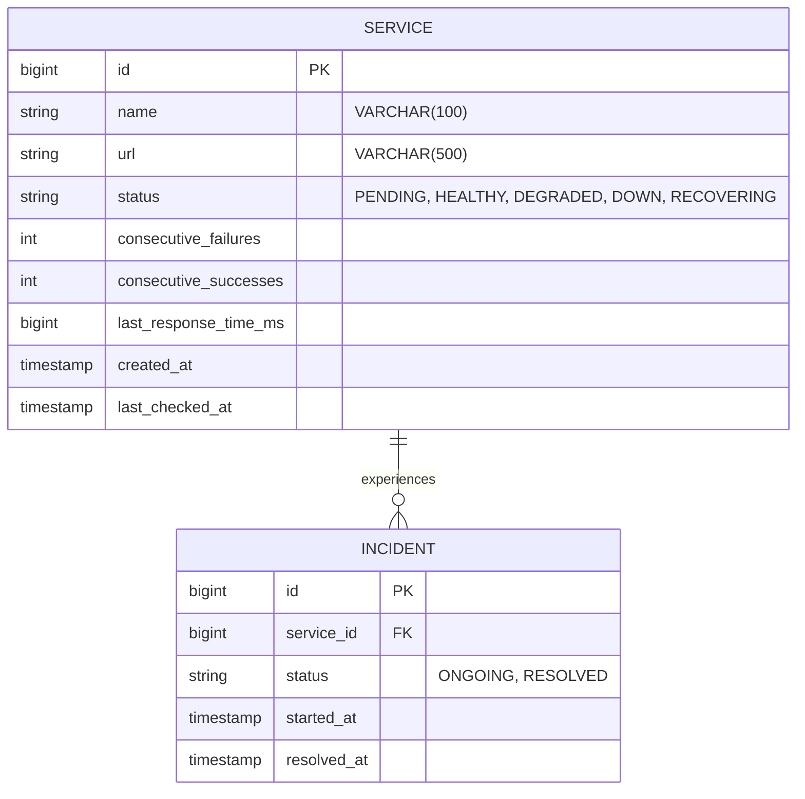
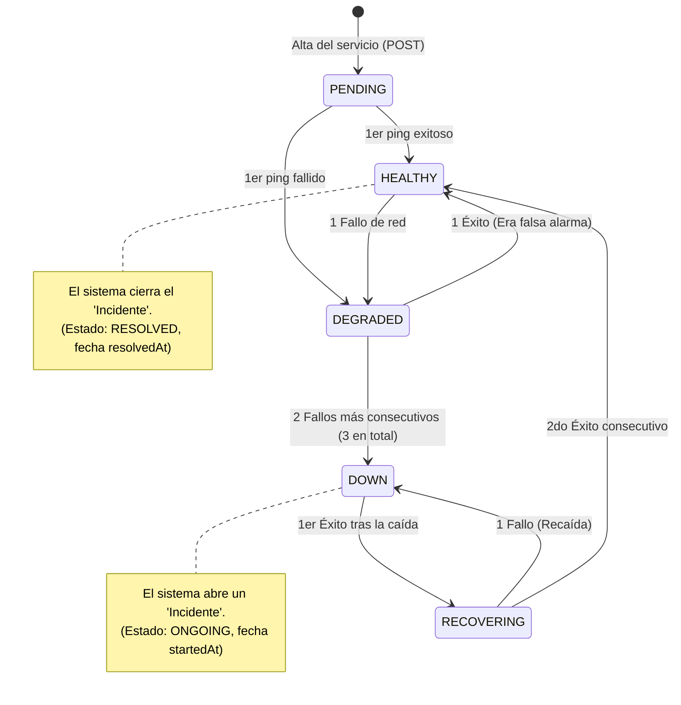

# Dominio y Reglas de Negocio

Este documento detalla la estructura lógica de los datos y las reglas exactas que dictan cómo se comporta la aplicación frente a los distintos escenarios. Define el núcleo funcional de **DeployOps**.

---

## 1. Esquema de Base de Datos (ERD)

### 1.1. Esquema Implementado en Producción (v1.0)
El modelo relacional persistido en PostgreSQL (Supabase / Docker local) vincula los servicios monitoreados con su historial de incidentes:

### 1.2. Extensiones Proyectadas (Roadmap Futuro)
En fases posteriores con autenticación activa, se incorporarán las entidades `USER` (propietario) y `ENVIRONMENT` (ambientes Staging, Production).

---

## 2. Máquina de Estados del Monitoreo

El sistema no genera incidentes al primer fallo de red para evitar los "falsos positivos" o parpadeos temporales. Sigue un flujo riguroso de confirmación:

---

## 3. Reglas Críticas del Sistema

### 3.1. Estado Inicial Honesto
* **Regla:** Al crear un servicio (`POST /api/endpoints`), el sistema no asume disponibilidad perfecta antes de chequearlo.
* **Comportamiento:** Se registra con estado `PENDING` y `uptimePercentage = 0.0`. En la primera ejecución del Scheduler pasa a `HEALTHY` si responde correctamente o a `DEGRADED` si falla.

### 3.2. Confirmación de Caídas (Tolerancia a fallos)
* **Regla:** Un solo *timeout* o error HTTP no marca el servicio como `DOWN`.
* **Comportamiento:** Pasa a un estado de alerta temporal (`DEGRADED`). Solo si el fallo persiste durante 3 ciclos de comprobación consecutivos, el servicio se considera caído oficialmente y se persiste un `IncidentEntity` con estado `ONGOING`.

### 3.3. Cierre de Incidentes por Estabilidad
* **Regla:** Un incidente en estado `ONGOING` solo puede pasar a `RESOLVED` tras confirmar que el servicio está estable.
* **Comportamiento:** Requiere 2 respuestas `HTTP 200 OK` consecutivas (`DOWN` $\rightarrow$ `RECOVERING` $\rightarrow$ `HEALTHY`). Al segundo éxito, se estampa la fecha `resolvedAt`.

### 3.4. Protección contra Ataques SSRF (Server-Side Request Forgery)
* **Regla:** La API no puede ser utilizada para escanear redes internas o infraestructura cloud privada.
* **Comportamiento:** `UrlSecurityValidator` rechaza esquemas que no sean `http`/`https`, nombres de host locales (`localhost`, `*.local`, `*.internal`), IPs privadas (10.x, 192.168.x, 172.16-31.x) y endpoints de metadatos cloud (`169.254.169.254`).

### 3.5. Integridad Referencial y Borrado Seguro
* **Regla:** Al eliminar un servicio (`DELETE /api/endpoints/{id}`), no deben quedar incidentes huérfanos ni errores de clave foránea en la base de datos.
* **Comportamiento:** La operación se ejecuta bajo una transacción atómica (`@Transactional`): verifica la existencia del ID (404 si no existe), elimina primero los incidentes asociados en `IncidentRepository` y finalmente elimina el servicio.

### 3.6. Cálculo Preciso de Disponibilidad (Uptime) sin N+1
* **Regla:** El cálculo de disponibilidad debe reflejar la ventana real con precisión de segundos sin degradar el rendimiento de la base de datos.
* **Comportamiento:** Se calculan los segundos de caída acumulados recortando incidentes que cruzan el inicio de la ventana de 30 días (`findOverlappingIncidents`). En consultas de listado múltiple, se procesa en una única consulta SQL en lote (`findOverlappingIncidentsForServices`) agrupada en memoria.
