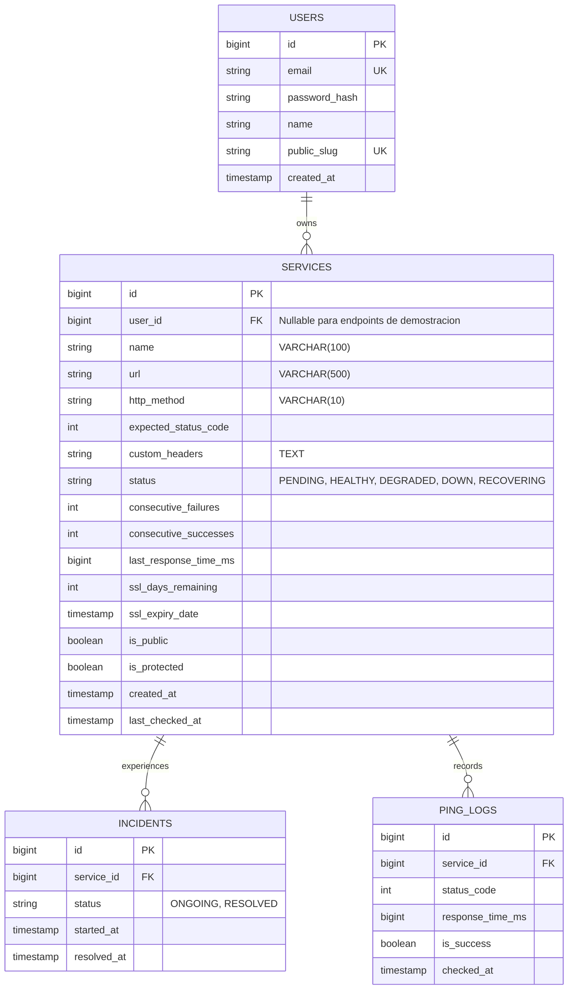
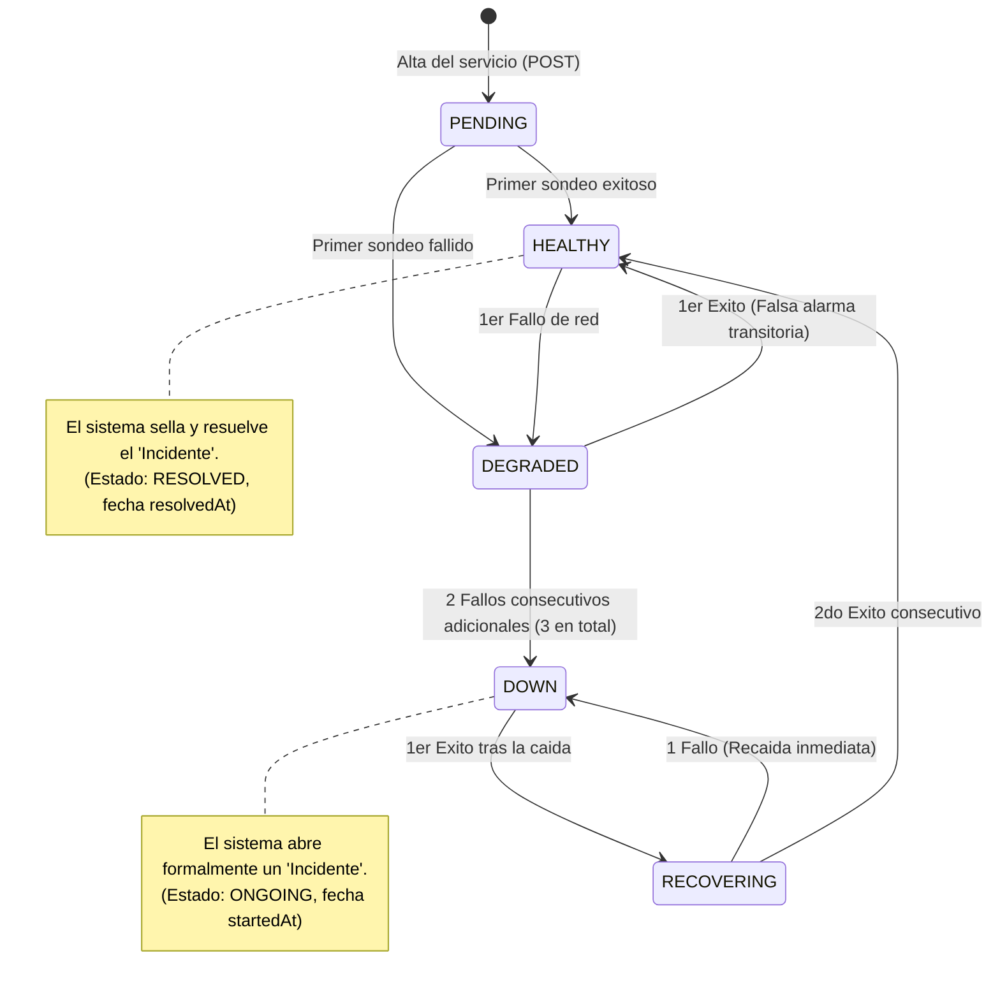

# Dominio y Reglas de Negocio

Este documento detalla la estructura logica de datos y las reglas exactas que dictan el comportamiento del motor de observabilidad en DeployOps.

---

## 1. Esquema de Base de Datos (ERD)

El modelo relacional persistido en PostgreSQL (Supabase en produccion / Docker local) estructura los servicios monitoreados, sus propietarios, la bitacora de incidentes y el registro de pings historicos:

---

## 2. Maquina de Estados Finitos del Monitoreo

El sistema implementa una maquina de estados finitos disenada para evitar falsos positivos y parpadeos temporales de red:

---

## 3. Reglas Criticas de Negocio

### 3.1. Estado Inicial Honesto
- **Regla:** Al crear un servicio (`POST /api/endpoints`), el sistema no asume disponibilidad perfecta antes de chequearlo.
- **Comportamiento:** Se registra con estado `PENDING` y `uptimePercentage = 0.0`. En la primera ejecucion del Scheduler pasa a `HEALTHY` si responde con el codigo esperado o a `DEGRADED` si presenta anomalias.

### 3.2. Tolerancia a Fallos y Declaracion de Caidas
- **Regla:** Un solo timeout o error de conexion no marca el servicio como `DOWN`.
- **Comportamiento:** El servicio pasa a estado de alerta temporal (`DEGRADED`). Solo si el fallo persiste durante tres ciclos consecutivos (3/3), el servicio transiciona oficialmente a `DOWN` y se persiste un registro `IncidentEntity` con estado `ONGOING`.

### 3.3. Resolucion de Incidentes por Estabilidad
- **Regla:** Un incidente en estado `ONGOING` unicamente transiciona a `RESOLVED` tras confirmar estabilidad comprobada.
- **Comportamiento:** Requiere dos respuestas satisfactorias consecutivas (`DOWN` -> `RECOVERING` -> `HEALTHY`). Al segundo exito, se estampa la marca temporal `resolvedAt` y se calcula la duracion total en segundos.

### 3.4. Escudo Defensivo contra SSRF
- **Regla:** La API no puede ser utilizada como vector para escanear redes internas, hosts locales o infraestructura cloud privada.
- **Comportamiento:** `UrlSecurityValidator` descarta esquemas no autorizados (restringiendo a `http` y `https`), bloquea nombres locales (`localhost`, `*.local`, `*.internal`, `*.arpa`), subredes privadas (RFC 1918), Carrier-Grade NAT (RFC 6598), endpoints de metadatos cloud (`169.254.169.254`) y puertos administrativos sensibles.

### 3.5. Aislamiento por Alcance (Dual-Scope)
- **Regla:** Los usuarios autenticados deben poder gestionar sus endpoints privados sin interferir con la infraestructura publica de demostracion.
- **Comportamiento:** El parametro `scope` filtra las consultas:
  - `scope=mine`: Retorna exclusivamente los endpoints asociados al usuario autenticado via su identificador JWT.
  - `scope=showcase`: Expone los endpoints de demostracion sembrados por la plataforma.
  - Los endpoints de demostracion poseen el flag `is_protected = true`, lo que impide su eliminacion accidental por parte de usuarios externos.

### 3.6. Calculo de Uptime SLA sin N+1 Queries
- **Regla:** La disponibilidad mensual debe calcularse sobre una ventana movil de 30 dias con precision de segundos y rendimiento constante.
- **Comportamiento:** Se utiliza el metodo `findOverlappingIncidentsForServices` de `IncidentRepository` que recupera todos los incidentes que intersectan la ventana de 30 dias en un unico viaje de red (`O(1)` consultas SQL). Los incidentes se agrupan en memoria y se calcula el tiempo de inactividad restando los solapamientos.

### 3.7. Purga Automatizada de Logs Historicos
- **Regla:** La tabla `ping_logs` no debe crecer de manera indefinida afectando el almacenamiento y la indexacion.
- **Comportamiento:** `MetricsHistoryService` ejecuta una tarea programada diaria que purga registros de ping con antiguedad superior a 30 dias, preservando unicamente los incidentes historicos consolidados.
