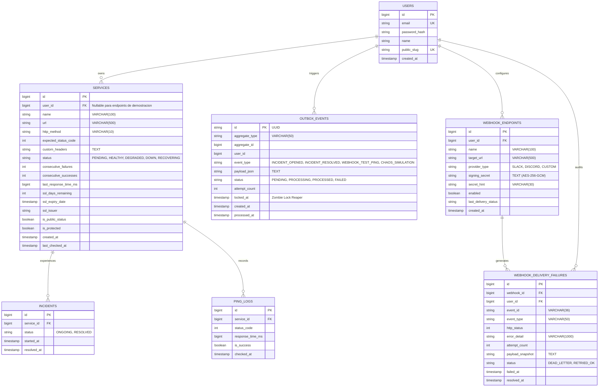
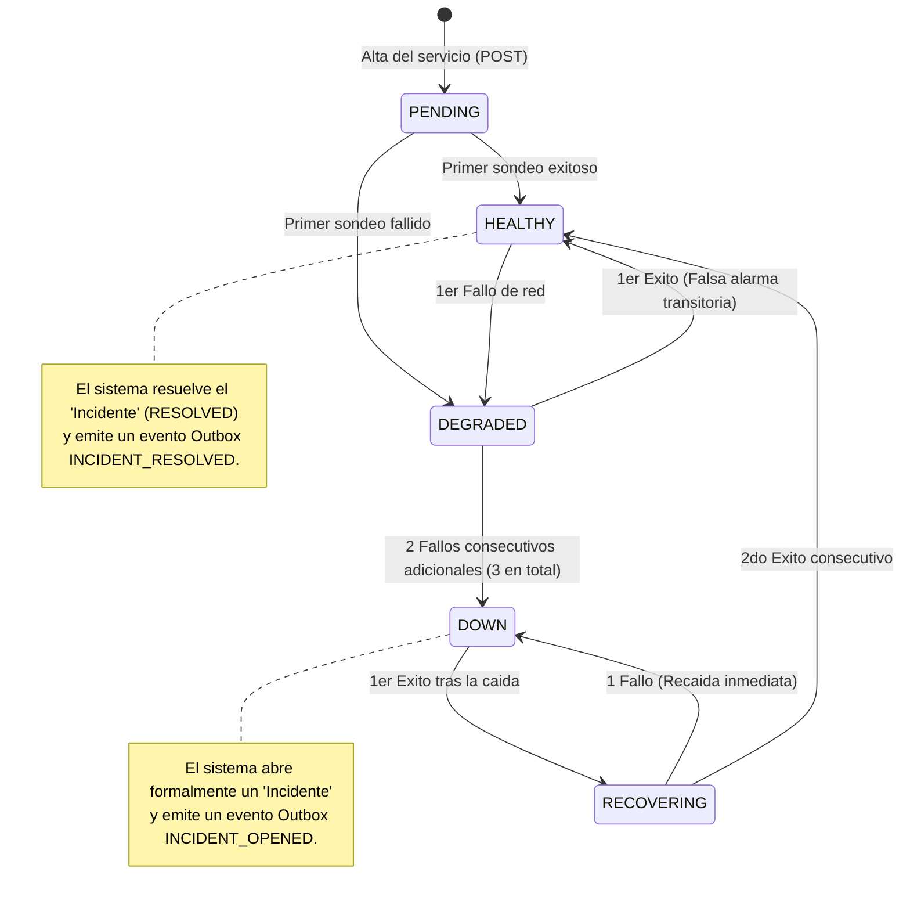

# Dominio y Reglas de Negocio — DeployOps v2.0 Enterprise

Este documento detalla la estructura logica de datos, las relaciones entidad-relacion y las reglas exactas que dictan el comportamiento del motor de observabilidad y notificaciones distribuidas en DeployOps.

---

## 1. Esquema de Base de Datos (ERD de 7 Tablas)

El modelo relacional persistido en PostgreSQL (Docker Compose local / Render / Supabase) estructura los servicios monitoreados, sus propietarios, la bitacora de incidentes, el registro de pings historicos, la cola transaccional Outbox, los canales de webhook y la auditoria de entregas fallidas (Dead Letter Queue):

---

## 2. Maquina de Estados Finitos del Monitoreo

El sistema implementa una maquina de estados finitos disenada para evitar falsos positivos y parpadeos temporales de red:

---

## 3. Reglas Criticas de Negocio

### 3.1. Estado Inicial Honesto
- **Regla:** Al crear un servicio (`POST /api/endpoints`), el sistema no asume disponibilidad perfecta antes de chequearlo.
- **Comportamiento:** Se registra con estado `PENDING` y `uptimePercentage = 0.0`. En la primera ejecucion del Scheduler pasa a `HEALTHY` si responde con el codigo esperado o a `DEGRADED` si presenta anomalias.

### 3.2. Tolerancia a Fallos y Declaracion de Caidas
- **Regla:** Un solo timeout o error de conexion no marca el servicio como `DOWN`.
- **Comportamiento:** El servicio pasa a estado de alerta temporal (`DEGRADED`). Solo si el fallo persiste durante tres ciclos consecutivos (3/3), el servicio transiciona oficialmente a `DOWN`, se persiste un registro `IncidentEntity` con estado `ONGOING` y se inserta atomica e inmutablemente un evento `INCIDENT_OPENED` en la tabla `outbox_events`.

### 3.3. Resolucion de Incidentes por Estabilidad
- **Regla:** Un incidente en estado `ONGOING` unicamente transiciona a `RESOLVED` tras confirmar estabilidad comprobada.
- **Comportamiento:** Requiere dos respuestas satisfactorias consecutivas (`DOWN` -> `RECOVERING` -> `HEALTHY`). Al segundo exito, se estampa la marca temporal `resolvedAt`, se calcula la duracion total en segundos y se emite el evento Outbox `INCIDENT_RESOLVED`.

### 3.4. Escudo Defensivo contra SSRF
- **Regla:** La API no puede ser utilizada como vector para escanear redes internas, hosts locales o infraestructura cloud privada.
- **Comportamiento:** `UrlSecurityValidator` descarta esquemas no autorizados (restringiendo a `http` y `https`), bloquea nombres locales (`localhost`, `*.local`, `*.internal`, `*.arpa`), subredes privadas (RFC 1918), Carrier-Grade NAT (RFC 6598), endpoints de metadatos cloud (`169.254.169.254`, `fd00:ec2::254`) y puertos administrativos sensibles (22, 3306, 5432, 6379, 2375, etc.).

### 3.5. Aislamiento por Alcance (Dual-Scope)
- **Regla:** Los usuarios autenticados deben poder gestionar sus endpoints privados sin interferir con la infraestructura publica de demostracion.
- **Comportamiento:** El parametro `scope` filtra las consultas:
  - `scope=mine`: Retorna exclusivamente los endpoints asociados al usuario autenticado via su identificador JWT.
  - `scope=showcase`: Expone los endpoints de demostracion sembrados por la plataforma.
  - Los endpoints de demostracion poseen el flag `is_protected = true`, lo que impide su eliminacion accidental por parte de usuarios externos.

### 3.6. Calculo de Uptime SLA sin N+1 Queries
- **Regla:** La disponibilidad mensual debe calcularse sobre una ventana movil de 30 dias con precision de segundos y rendimiento constante.
- **Comportamiento:** Se utiliza el metodo `findOverlappingIncidentsForServices` de `IncidentRepository` que recupera todos los incidentes que intersectan la ventana de 30 dias en un unico viaje de red (`O(1)` consultas SQL). Los incidentes se agrupan en memoria y se calcula el tiempo de inactividad restando los solapamientos.

### 3.7. Purga Automatizada de Logs Historicos
- **Regla:** La tabla `ping_logs` no debe crecer de manera indefinida afectando el almacenamiento y la indexacion.
- **Comportamiento:** `MetricsHistoryService` ejecuta una tarea programada diaria protegida por ShedLock que purga registros de ping con antiguedad superior a 30 dias, preservando unicamente los incidentes historicos consolidados.

### 3.8. Consistencia Transaccional Outbox (Cero Alertas Perdidas)
- **Regla:** Ningun incidente puede existir en PostgreSQL sin su correspondiente alerta garantizada, ni pueden perderse alertas por microcortes de RabbitMQ o reinicios de nodo.
- **Comportamiento:** Toda apertura o cierre de incidente se escribe en `outbox_events` con estado `PENDING` dentro de la misma transaccion `@Transactional`. El relay (`OutboxRelayService`) adquiere lotes marcando estado `PROCESSING` y estampa `locked_at`. Si un nodo colapsa en pleno despacho, el *Zombie Lock Reaper* detecta bloqueos de mas de 2 minutos y los retorna a `PENDING` para su recuperacion inmediata por otro nodo. Los eventos completados se depuran automaticamente a los 7 dias.

### 3.9. Cifrado y Rotacion de Secretos de Webhook (AES-256-GCM)
- **Regla:** Los secretos compartidos de firma (`whsec_...`) jamas se almacenan en texto plano en la base de datos ni se exponen de forma recurrente por la API REST.
- **Comportamiento:** Cada secreto se cifra mediante `SecretCryptoConverter` con `AES-256-GCM` y un IV aleatorio de 12 bytes. Al crearse o rotarse, la respuesta HTTP 201/200 expone el secreto plano `rawSecretOnce` una unica vez; toda peticion de lectura subsiguiente unicamente recibe la pista enmascarada `secretHint` (`whsec_••••••••4f9a`).

### 3.10. Verificacion Criptografica y Ventana Anti-Replay (HMAC-SHA256)
- **Regla:** Los receptores de webhooks deben poder autenticar la legitimidad del remitente y repeler ataques de repeticion de eventos capturados en red.
- **Comportamiento:** `WebhookDeliveryService` calcula la cabecera `X-DeployOps-Signature-256: sha256=<hex>` sobre la concatenacion canonica `timestampEpochSeconds + "." + rawJsonBody`. Se establece una ventana estricta de tolerancia de 300 segundos (5 minutos) y los clientes deben comparar el digesto en tiempo constante (`timingSafeEqual` / `MessageDigest.isEqual`).

### 3.11. Resiliencia de Despacho, Backoff con Jitter y Dead Letter Queue (DLQ)
- **Regla:** Fallos transitorios de red o timeouts en servidores receptores no deben saturar la cola de despacho ni perder mensajes definitivos.
- **Comportamiento:** El despachador ejecuta hasta 3 intentos por hilo virtual aplicando retroceso exponencial con fluctuacion aleatoria (*Jitter* +/- 20%): intento 1 a ~2s, intento 2 a ~8s e intento 3 a ~30s. Si el destino responde con 5xx o agota los 3 intentos, el mensaje es derivado a la Dead Letter Queue (`webhooks.dlq`), persiste en `webhook_delivery_failures` con estado `DEAD_LETTER` y habilita el reintento manual asistido desde la consola SRE.

### 3.12. Prevencion de DNS Rebinding Pre-Vuelo y Cuota de Lectura de 4 KB
- **Regla:** Un dominio publico registrado legitimamente no puede resolver posteriormente hacia direcciones privadas de la red local (DNS Rebinding), ni un servidor externo puede provocar Denegacion de Servicio (DoS) retornando respuestas gigantescas.
- **Comportamiento:** Antes de cada intento HTTP, `WebhookDeliveryService` re-ejecuta `UrlSecurityValidator.validatePublicUrl()` sobre el dominio destino, prohibe redirecciones HTTP (3xx) y trunca la lectura del stream de respuesta a un maximo estricto de 4096 bytes (4 KB).
